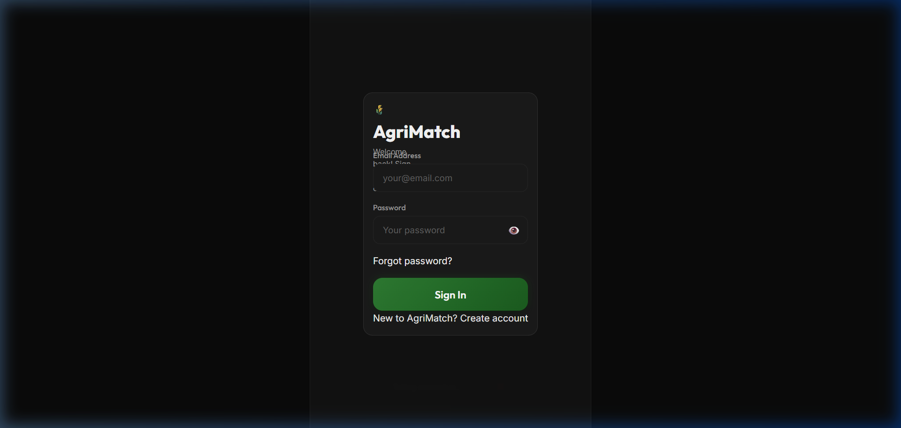
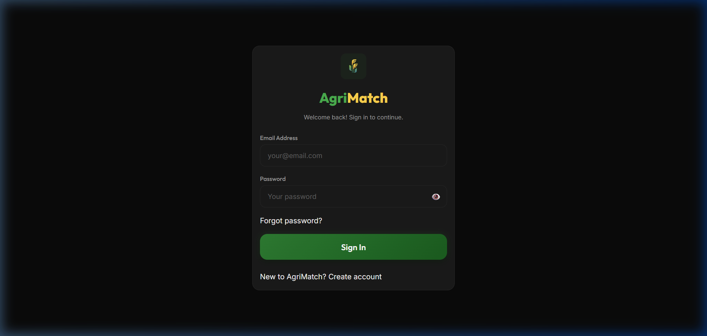
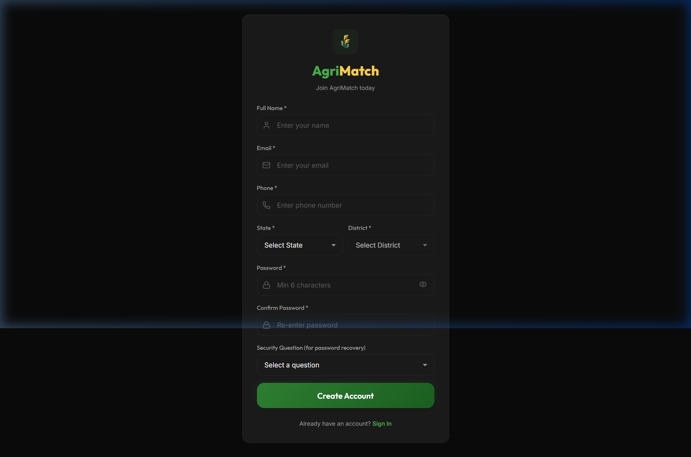
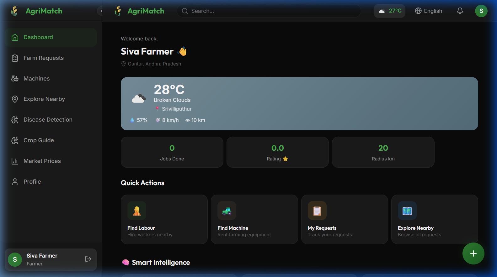
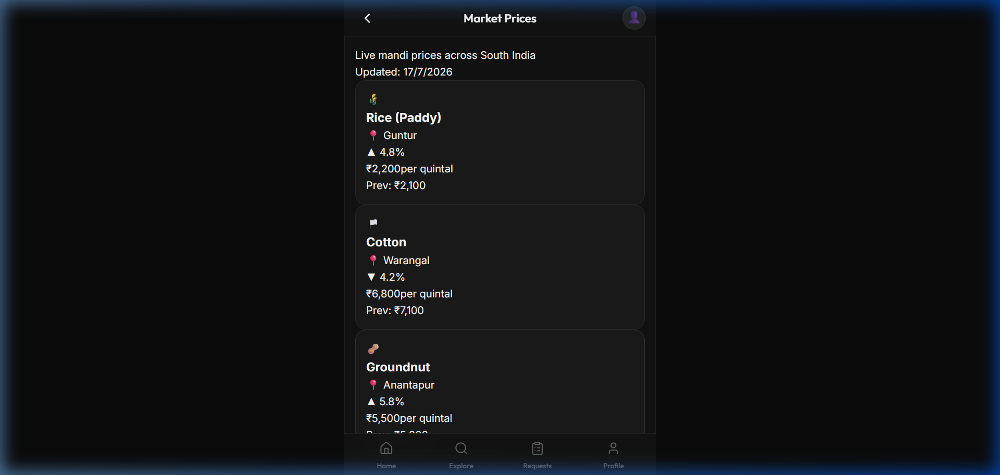
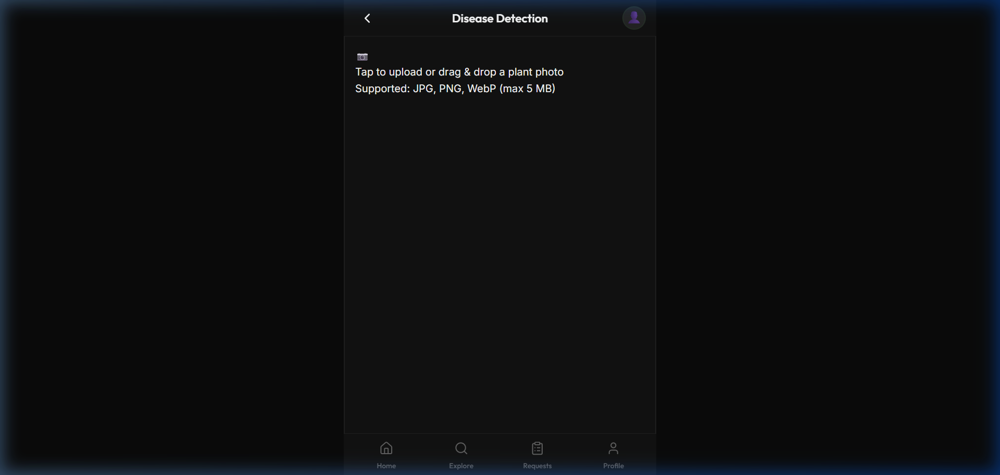
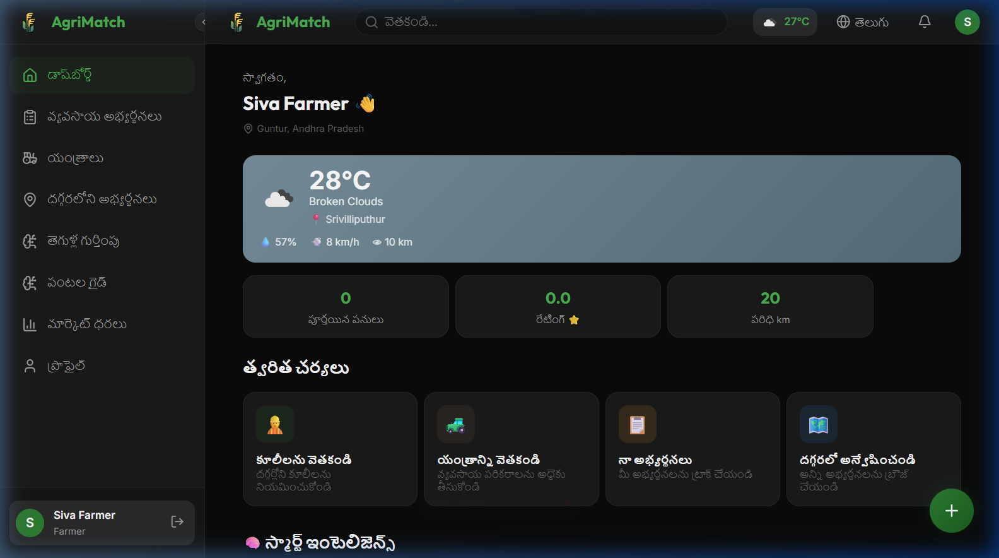
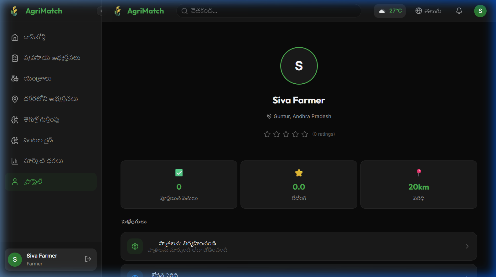

# 🌾 AgriMatch — Farm Job Platform

> A mobile-first React web application that connects **farmers**, **labour workers**, and **machine owners** in rural India. Built with Vite + React 19.

---

## 🎯 Project Purpose

AgriMatch bridges the gap between farmers who need help and workers/machine owners who are available nearby. It also provides smart agricultural tools (disease detection, crop recommendation, market prices) to empower rural farmers with data-driven decisions.

---

## 🏗️ Tech Stack

| Layer | Technology |
|---|---|
| **Frontend Framework** | React 19 |
| **Build Tool** | Vite 8 |
| **Routing** | React Router DOM v7 |
| **Icons** | Lucide React |
| **Styling** | Vanilla CSS (custom design system) |
| **State Management** | React Context API |
| **Storage** | localStorage (mock backend) |
| **Backend folder** | Present but not yet wired |

---

## 🖼️ Application Screenshots

### 🔑 Authentication & Signup

| Landing Splash | Branded Sign In | Account Registration |
| :---: | :---: | :---: |
|  |  |  |

### 🚜 SaaS Desktop Dashboard & Features

| Desktop Dashboard Home | Live Mandi Prices | AI Plant Disease Detection |
| :---: | :---: | :---: |
|  |  |  |

### 🌐 Instant Localization & Profile Management

| Instant Telugu Translation | Multi-lingual Profile Settings |
| :---: | :---: |
|  |  |

---


## 👥 User Roles

The platform supports **3 distinct user roles**, selected at registration:

| Role | Icon | Description |
|---|---|---|
| **Farmer** | 👨‍🌾 | Posts job requests (harvest, ploughing, spraying, etc.) |
| **Labour Worker** | 👷 | Browses and accepts nearby farm job requests |
| **Machine Owner** | 🚜 | Provides machinery services to farmers |

---

## 📱 Pages & Features

### 🔐 Authentication Flow

| Page | Route | Description |
|---|---|---|
| Splash | `/` | Animated landing screen |
| Login | `/login` | Email + password login |
| Register | `/register` | New account creation |
| Role Selection | `/role-selection` | Pick Farmer / Labour / Machine Owner |

### 🏠 Core App Pages

| Page | Route | Who Uses It | Description |
|---|---|---|---|
| **Home** | `/home` | All users | Dashboard with stats, quick actions, recent activity |
| **Create Request** | `/create-request` | Farmer | Post a farm job — category, workers needed, date, pay, location |
| **Nearby Requests** | `/nearby` | Labour / Machine | Browse job postings near their location |
| **Request Detail** | `/request/:id` | All | Full view of a job posting, accept/withdraw |
| **My Requests** | `/my-requests` | All | View posted or accepted jobs |
| **Profile** | `/profile` | All | Edit personal info, view ratings, earnings history |

### 🌿 Agricultural Intelligence Pages

| Page | Route | Description |
|---|---|---|
| **Disease Detection** | `/disease-detection` | Upload crop photo → get diagnosis + treatment |
| **Crop Recommendation** | `/crop-recommendation` | Select state + season → get best crop suggestions |
| **Market Insights** | `/market-insights` | Live-like mandi prices with trend indicators |

---

## ⚙️ Algorithms Used

### 1. 🔄 FCFS — First Come First Served
**File:** `src/utils/fcfs.js`

**Used for: Job Request Acceptance**

Workers who accept a job request are processed strictly in the order they click "Accept". The queue fills up slot by slot until `workersAccepted >= workersNeeded`.

```
┌─────────────────────────────────────────────┐
│  Farmer posts: "Need 3 workers for harvest" │
│                                             │
│  Worker A accepts → slot 1/3 filled         │
│  Worker B accepts → slot 2/3 filled         │
│  Worker C accepts → slot 3/3 filled ✅       │
│  Request status → "active"                  │
│  Worker D tries → ❌ "Request Full"          │
└─────────────────────────────────────────────┘
```

**Validation rules in FCFS:**
- ❌ Cannot accept own request (farmer)
- ❌ Cannot accept twice (duplicate check)
- ❌ Cannot accept if request is `completed` or `expired`
- ✅ Status auto-changes to `active` when all slots filled

---

### 2. 📍 Haversine Formula — Geo-Distance Calculation
**File:** `src/utils/distance.js`

**Used for: Nearby Requests filtering**

Calculates the great-circle distance (in km) between two GPS coordinates (latitude/longitude) on the Earth's surface. This is the standard algorithm used in mapping apps.

```
Formula:
  a = sin²(Δlat/2) + cos(lat1) × cos(lat2) × sin²(Δlng/2)
  c = 2 × atan2(√a, √(1−a))
  d = R × c     (R = 6371 km = Earth's radius)
```

**Functions:**
- `calculateDistance(lat1, lng1, lat2, lng2)` → returns km
- `isWithinRange(userLoc, targetLoc, rangeKm)` → boolean filter
- `formatDistance(km)` → human-readable "2.5 km" or "800m"

---

### 3. 🧠 Rule-Based Matching — Crop Recommendation
**File:** `src/data/intelligence.js`

**Used for: Crop Recommendation Engine**

A **lookup-table / rule-based recommendation system** that maps:

```
State (AP, TS, TN, KA, KL) × Season (Kharif / Rabi)
    → Best Crops with yield, risk, water need, soil type
```

**Season detection logic:**
```js
if (month >= 5 && month <= 10) → "kharif"  // Jun–Nov, monsoon
else                           → "rabi"    // Nov–Apr, winter
```

States covered: Andhra Pradesh, Telangana, Tamil Nadu, Karnataka, Kerala

---

### 4. 🔬 Pattern Matching — Disease Detection
**File:** `src/data/intelligence.js`

**Used for: Crop Disease Diagnosis**

A **simulated AI diagnostic engine** backed by a structured disease database. When a user uploads a crop photo, it matches from the disease database (mocking a real ML model) and returns:

- Disease name + confidence score (85–94%)
- Severity level (high / medium / low)
- Cause, symptoms, prevention steps
- Recommended medicines with dosage

**Diseases in the database:**

| Disease | Crop | Confidence |
|---|---|---|
| Leaf Blight | Rice | 89% |
| Powdery Mildew | Tomato | 92% |
| Bacterial Wilt | Brinjal | 85% |
| Yellow Mosaic Virus | Black Gram | 94% |
| Leaf Rust | Wheat | 88% |

> 💡 In a production app, this would be replaced with a real CNN/ML model (e.g., PlantVillage dataset trained model).

---

### 5. 📊 Price Trend Indicator — Market Insights
**File:** `src/data/intelligence.js`

**Used for: Mandi Price Display**

Compares current vs previous prices and calculates:

```js
trend   = (currentPrice > previousPrice) ? "up" : "down"
change% = ((currentPrice - previousPrice) / previousPrice) × 100
```

Covers 10 major crops: Rice, Cotton, Groundnut, Red Gram, Maize, Chillies, Sugarcane, Ragi, Coconut, Black Gram.

---

## 🗂️ Project Structure

```
src/
├── App.jsx                    # Router + Auth guards
├── main.jsx                   # Entry point
├── index.css                  # Global design system
│
├── context/
│   ├── AuthContext.jsx        # User auth state (login/register/logout)
│   └── AppContext.jsx         # Global app state (requests, toast)
│
├── pages/
│   ├── Splash.jsx             # Landing screen
│   ├── Login.jsx              # Login page
│   ├── Register.jsx           # Registration
│   ├── RoleSelection.jsx      # Role picker
│   ├── Home.jsx               # Dashboard
│   ├── CreateRequest.jsx      # Post a farm job
│   ├── NearbyRequests.jsx     # Browse nearby jobs
│   ├── RequestDetail.jsx      # Job detail + accept
│   ├── MyRequests.jsx         # My posted/accepted jobs
│   ├── Profile.jsx            # User profile
│   ├── DiseaseDetection.jsx   # AI disease scanner
│   ├── CropRecommendation.jsx # Crop advisor
│   └── MarketInsights.jsx     # Mandi prices
│
├── components/
│   ├── Header.jsx             # Top navigation bar
│   ├── BottomNav.jsx          # Mobile bottom navigation
│   ├── RequestCard.jsx        # Job listing card
│   ├── Modal.jsx              # Reusable modal dialog
│   ├── RatingStars.jsx        # Star rating display
│   ├── StatusBadge.jsx        # Status tag (pending/active/etc.)
│   └── Toast.jsx              # Notification toasts
│
├── utils/
│   ├── fcfs.js                # ⚡ FCFS job acceptance algorithm
│   ├── distance.js            # 📍 Haversine distance formula
│   ├── helpers.js             # Date/price/text formatters
│   └── storage.js             # localStorage read/write wrapper
│
└── data/
    ├── intelligence.js        # 🧠 Disease DB, crop recommendations, market prices
    ├── categories.js          # Job categories (harvest, ploughing, etc.)
    ├── mockRequests.js        # Sample job request data
    └── mockUsers.js           # Sample user data
```

---

## 🧩 Key Components

| Component | Purpose |
|---|---|
| `Header.jsx` | App bar with title and back navigation |
| `BottomNav.jsx` | Mobile-style tab bar (Home, Nearby, Requests, Profile) |
| `RequestCard.jsx` | Card showing job title, pay, distance, worker slots |
| `StatusBadge.jsx` | Color-coded badge: ⏳ Pending / ✅ Active / 🏁 Completed / ⏰ Expired |
| `RatingStars.jsx` | 1–5 star visual rating component |
| `Toast.jsx` | Auto-dismissing success/error notification |
| `Modal.jsx` | Overlay dialog for confirmations |

---

## 🔒 Auth & Route Guards

Two route guard types:
- **ProtectedRoute** — redirects unauthenticated users to `/login`
- **PublicRoute** — redirects already-logged-in users to `/home`

Session is stored in **localStorage** via `AuthContext`.

---

## 📦 Dependencies

| Package | Version | Purpose |
|---|---|---|
| `react` | ^19.2.6 | UI framework |
| `react-dom` | ^19.2.6 | DOM rendering |
| `react-router-dom` | ^7.15.0 | Client-side routing |
| `lucide-react` | ^1.14.0 | SVG icon library |
| `vite` | ^8.0.12 | Build tool & dev server |

---

## 🚀 Running the App

```bash
# Install dependencies
npm install

# Start development server
npm run dev

# Open in browser
http://localhost:5173/
```

---

## 🔑 Test Login Credentials

To quickly explore the dashboard and premium SaaS layouts, you can sign in with this pre-configured test account:

*   **Email:** `siva_test@gmail.com`
*   **Password:** `password123`


## 🔮 Future Enhancements

- 🌐 Real backend (Node.js/Express or Firebase)
- 🤖 Actual ML model for disease detection (PlantVillage CNN)
- 📡 Live mandi prices via government APIs (Agmarknet)
- 🗺️ Real GPS geolocation for Nearby Requests
- 💬 In-app chat between farmer and worker
- 💳 Payment integration (UPI/Razorpay)
- 📱 PWA support for offline usage
